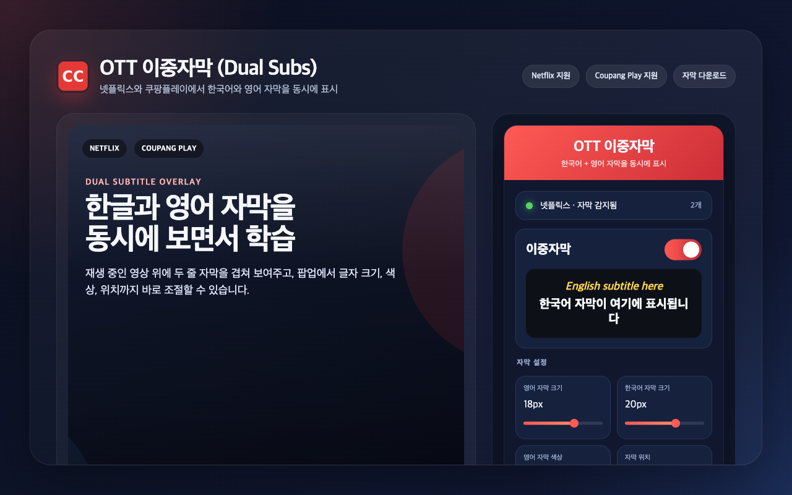

# OTT 이중자막 (Dual Subs)

쿠팡플레이와 넷플릭스에서 한국어와 영어 자막을 동시에 보여주는 크롬 확장프로그램입니다.

## 소개

OTT 이중자막 (Dual Subs)은 영상 시청과 영어 학습을 함께 하고 싶은 사용자를 위해 만든 크롬 확장프로그램입니다.
쿠팡플레이와 넷플릭스의 기본 자막 메뉴에 "한국어+영어" 옵션을 추가하고,
영상 위에 한국어 자막과 영어 자막을 동시에 오버레이로 표시합니다.

기본 자막을 끄고 따로 번거로운 설정을 반복할 필요 없이,
확장프로그램 팝업에서 이중자막을 켜고 자막 크기, 색상, 위치를 조절해 자신에게 맞는 시청 환경을 만들 수 있습니다.

## 스크린샷

### 서비스 미리보기

### Chrome Web Store 등록 화면

### 개인정보처리방침 등록 화면

## Chrome Web Store 노출용 설명

### 짧은 소개
쿠팡플레이와 넷플릭스에서 한국어+영어 자막을 동시에 보여주는 이중자막 확장프로그램입니다.

### 상세 설명
OTT 이중자막 (Dual Subs)은 쿠팡플레이와 넷플릭스에서 한국어와 영어 자막을 함께 보여주어,
영상 시청과 영어 학습을 더 편하게 만들어주는 크롬 확장프로그램입니다.

기본 자막 메뉴에 "한국어+영어" 옵션을 추가해 자연스럽게 사용할 수 있고,
영상 위 오버레이로 두 언어 자막을 동시에 표시합니다.
영어 자막 색상, 한국어/영어 자막 크기, 자막 위치도 간단하게 조절할 수 있습니다.

쿠팡플레이나 넷플릭스에서 콘텐츠를 시청할 때
"한국어는 이해용, 영어는 표현 학습용"으로 함께 보고 싶은 분들에게 특히 유용합니다.
자막이 감지되면 팝업에서 현재 자막 상태를 확인할 수 있고,
감지된 자막 파일을 다운로드하는 기능도 함께 제공합니다.

### 주요 기능
- 쿠팡플레이 지원
- 넷플릭스 지원
- 한국어 + 영어 동시 자막 표시
- 영어 자막 색상 변경
- 한국어/영어 자막 크기 조절
- 자막 위치 조절
- 감지된 자막 다운로드 지원

## 이런 분들께 추천합니다

- 미드를 보며 영어 표현을 함께 익히고 싶은 사용자
- 한국어 자막과 영어 자막을 동시에 비교해 보고 싶은 사용자
- OTT 시청 중 따로 자막 파일을 찾지 않고 바로 학습하고 싶은 사용자
- 쿠팡플레이와 넷플릭스를 모두 사용하는 사용자

## 사용 방법

1. 크롬에 확장프로그램을 설치합니다.
2. 쿠팡플레이 또는 넷플릭스에서 영상을 재생합니다.
3. 자막 메뉴에서 "한국어+영어" 옵션을 선택합니다.
4. 확장프로그램 팝업에서 이중자막을 켜고 자막 크기, 영어 자막 색상, 위치를 조절합니다.
5. 필요하면 감지된 자막 파일을 다운로드해 복습에 활용할 수 있습니다.

## 지원 플랫폼

- 쿠팡플레이
- 넷플릭스

## 핵심 가치

- 시청 흐름을 해치지 않는 자연스러운 이중자막 경험
- 영어 학습과 콘텐츠 감상을 동시에 할 수 있는 사용성
- 복잡한 설정 없이 바로 쓸 수 있는 간단한 UI

## v2.1.0 개발판: 표현과 번역 이유 해설

아직 Chrome Web Store에 제출하지 않은 로컬 개발판입니다.

### 사용 흐름
1. 이중자막을 켠 뒤 영어 자막 또는 **표현 해설** 버튼을 누릅니다.
2. 영상이 일시정지되고, 현재 영·한 자막과 문맥 해설 패널이 열립니다. 영어 자막을 드래그하면 선택한 표현도 전달합니다.
3. 표현 단위 뜻, 단어의 결합 방식, 한국어 자막이 다르게 번역된 이유, 영·한 예문을 봅니다.
4. **닫기 / Esc**는 재생하지 않고 닫습니다. **이어서 보기**를 눌러야 재생합니다.

`The actionable intel comes with a tight clock,` 문장에는 내장 예문 해설이 있습니다. 이 해설은 정확히 이 문장에만 표시하며 다른 대사의 AI 결과로 대신하지 않습니다.

### 선택적 Gemini 연결
- 팝업의 **AI 연결 설정**에서 개인 Gemini API 키와 전송 동의를 입력합니다.
- 키는 브라우저 세션의 확장 프로그램 전용 저장소에만 보관합니다. 재시작 뒤에는 다시 연결해야 합니다. 웹페이지/콘텐츠 스크립트에 키를 전달하지 않습니다.
- 사용자가 패널의 **AI로 이 문장 해설**을 누를 때만 요청합니다. 계속 재생하거나 패널만 열어서는 AI 요청이 발생하지 않습니다.
- 전송 범위: 현재 영어/한국어 자막과 선택한 표현. 바로 앞뒤 영어 자막 각각 1개는 설정에서 선택한 경우에만 포함합니다. 영상·음성·시청 URL·전체 자막은 보내지 않습니다.
- 제공자의 요금·데이터 처리 정책이 적용될 수 있습니다. 이 확장은 무료 사용을 보장하지 않습니다.
- 서비스 워커에서 API 요청·타임아웃·오류 처리를 담당하고 결과는 일반 텍스트로만 렌더링합니다. AI 해설은 틀릴 수 있으며 자막에 없는 장면 정보를 확정하지 않도록 지시합니다.

### 로컬 설치와 확인
Chrome 확장 프로그램 페이지에서 개발자 모드를 켜고 `ott-dual-subs-v2` 폴더를 **압축해제된 확장 프로그램 로드**로 불러옵니다. 이미 스토어판을 사용 중이면 동일 사이트에 두 확장이 동시에 자막을 주입하지 않도록 주의하세요. 설정 변경은 사용자가 선택합니다.

- 단위 테스트: `node --test tests/*.test.js`
- 브라우저 UI 테스트 픽스처: `tests/study-browser.html` (로컬 HTTP로 제공)
- 실제 API 요청은 개발 테스트에서 하지 않았습니다. 개인 키 연결 후 별도 확인이 필요합니다.
- Chrome Web Store 제출 전: 선택적 AI 전송에 맞춰 개인정보처리방침/스토어 데이터 취급 고지를 수정하고, 실제 설치 환경의 쿠팡플레이·넷플릭스·전체화면을 재확인해야 합니다. 기존의 “외부 전송 없음” 설명을 그대로 사용하면 안 됩니다.
