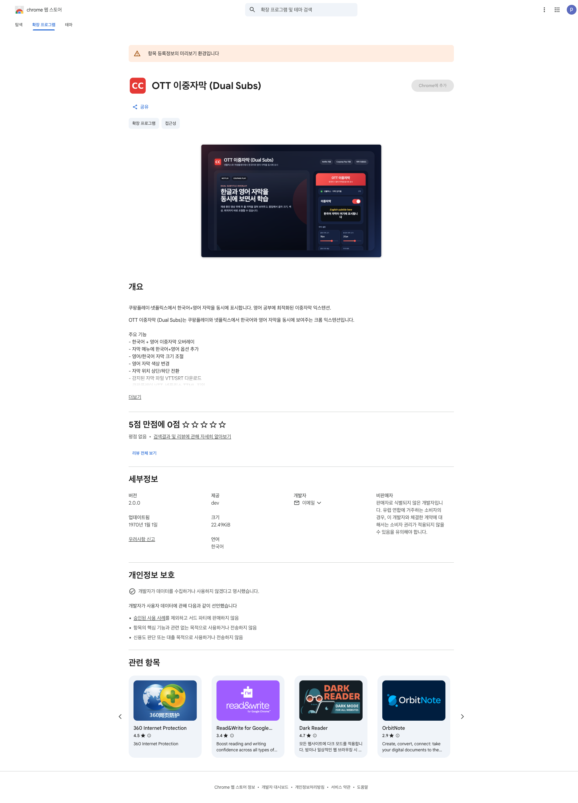
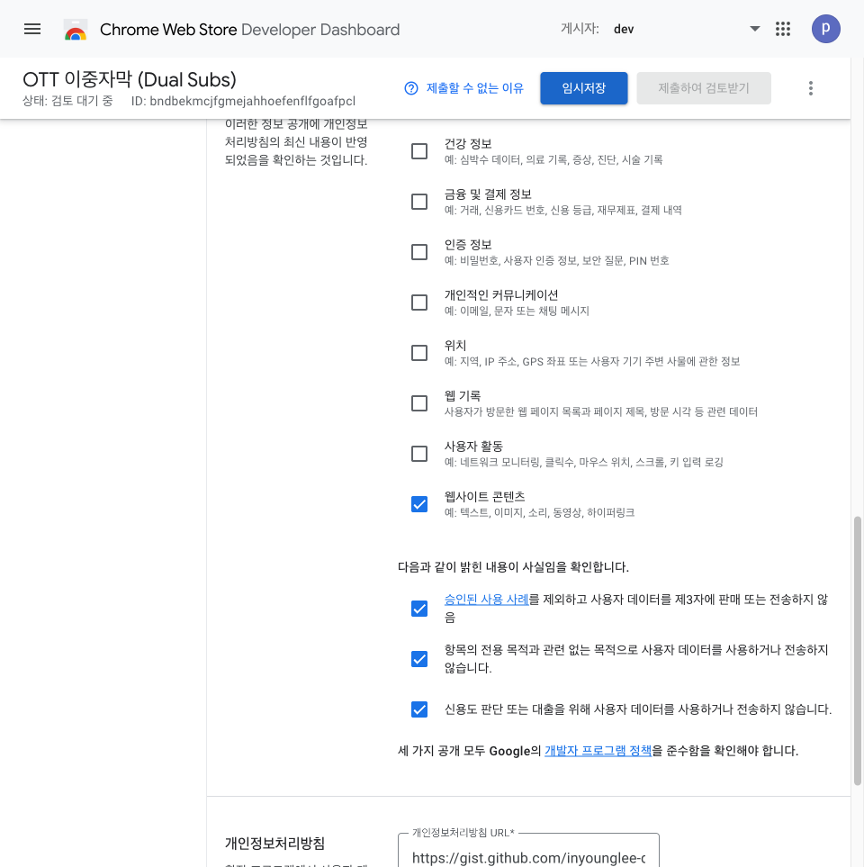

# OTT 이중자막 (Dual Subs)

쿠팡플레이와 넷플릭스에서 한국어와 영어 자막을 동시에 보여주는 크롬 확장프로그램입니다.

## 소개

OTT 이중자막 (Dual Subs)은 영상 시청과 영어 학습을 함께 하고 싶은 사용자를 위해 만든 크롬 확장프로그램입니다.
쿠팡플레이와 넷플릭스의 기본 자막 메뉴에 "한국어+영어" 옵션을 추가하고,
영상 위에 한국어 자막과 영어 자막을 동시에 오버레이로 표시합니다.

기본 자막을 끄고 따로 번거로운 설정을 반복할 필요 없이,
확장프로그램 팝업에서 이중자막을 켜고 자막 크기, 색상, 위치를 조절해 자신에게 맞는 시청 환경을 만들 수 있습니다.

## 스크린샷

### 서비스 미리보기

### Chrome Web Store 등록 화면

### 개인정보처리방침 등록 화면

## Chrome Web Store 노출용 설명

### 짧은 소개
쿠팡플레이와 넷플릭스에서 한국어+영어 자막을 동시에 보여주는 이중자막 확장프로그램입니다.

### 상세 설명
OTT 이중자막 (Dual Subs)은 쿠팡플레이와 넷플릭스에서 한국어와 영어 자막을 함께 보여주어,
영상 시청과 영어 학습을 더 편하게 만들어주는 크롬 확장프로그램입니다.

기본 자막 메뉴에 "한국어+영어" 옵션을 추가해 자연스럽게 사용할 수 있고,
영상 위 오버레이로 두 언어 자막을 동시에 표시합니다.
영어 자막 색상, 한국어/영어 자막 크기, 자막 위치도 간단하게 조절할 수 있습니다.

쿠팡플레이나 넷플릭스에서 콘텐츠를 시청할 때
"한국어는 이해용, 영어는 표현 학습용"으로 함께 보고 싶은 분들에게 특히 유용합니다.
자막이 감지되면 팝업에서 현재 자막 상태를 확인할 수 있고,
감지된 자막 파일을 다운로드하는 기능도 함께 제공합니다.

### 주요 기능
- 쿠팡플레이 지원
- 넷플릭스 지원
- 한국어 + 영어 동시 자막 표시
- 영어 자막 색상 변경
- 한국어/영어 자막 크기 조절
- 자막 위치 조절
- 감지된 자막 다운로드 지원

## 이런 분들께 추천합니다

- 미드를 보며 영어 표현을 함께 익히고 싶은 사용자
- 한국어 자막과 영어 자막을 동시에 비교해 보고 싶은 사용자
- OTT 시청 중 따로 자막 파일을 찾지 않고 바로 학습하고 싶은 사용자
- 쿠팡플레이와 넷플릭스를 모두 사용하는 사용자

## 사용 방법

1. 크롬에 확장프로그램을 설치합니다.
2. 쿠팡플레이 또는 넷플릭스에서 영상을 재생합니다.
3. 자막 메뉴에서 "한국어+영어" 옵션을 선택합니다.
4. 확장프로그램 팝업에서 이중자막을 켜고 자막 크기, 영어 자막 색상, 위치를 조절합니다.
5. 필요하면 감지된 자막 파일을 다운로드해 복습에 활용할 수 있습니다.

## 지원 플랫폼

- 쿠팡플레이
- 넷플릭스

## 핵심 가치

- 시청 흐름을 해치지 않는 자연스러운 이중자막 경험
- 영어 학습과 콘텐츠 감상을 동시에 할 수 있는 사용성
- 복잡한 설정 없이 바로 쓸 수 있는 간단한 UI

## v2.2.0 개발판: 자막 옆 주석 + 재사용 표현 사전

기본 화면은 클릭·일시정지 없이 자막 좌우 빈 공간에 짧은 표현 주석을 최대 2개 표시합니다. 여백이 부족하면 하나로 줄이거나 숨기며 자막을 가리지 않습니다.

### 강·중·약
- **강:** 모든 대사를 대상으로 합니다. 짧은 인사도 사전에서 재사용합니다.
- **중 (추천·기본값):** 자주 쓰는 주요 표현·구동사·연어를 중심으로 고릅니다. 단순 인사나 일반 단어, 전문용어만 있는 대사는 기본적으로 건너뜁니다.
- **약:** 전문용어 위주로 표시합니다. 일상 표현은 제외합니다.

팝업 또는 옵션 화면에서 API 키 없이 깊이를 바꿀 수 있고, 재시작 후에도 유지합니다. 중·약의 후보 선별은 로컬 표현·용어 목록 기반의 보수적 규칙입니다. 모든 영어 표현을 인식하는 통계적 난이도 분류기는 아니므로 일부 표현을 놓칠 수 있습니다.

### 생성 전에 사전부터
1. 현재 문장 전체가 아니라 **표현 단위**로 기본/저장 사전을 조회합니다. 명시된 활용형·대소문자·공백 차이는 함께 처리하고 단어 일부 일치는 막습니다.
2. 같은 뜻으로 쓸 수 있는 표현이 있으면 다른 문장·다른 작품에서도 재사용합니다. API 연결이 없어도 사전은 작동합니다.
3. 사전에 없고 선택한 깊이에 맞는 후보일 때만, AI 연결과 자동 전송에 별도로 동의한 경우 생성합니다. 동시 동일 요청은 한 번으로 합칩니다.
4. 성공한 표현은 이 브라우저의 확장 전용 로컬 사전에 저장합니다. 서비스 워커나 브라우저 재시작 이후에도 남습니다. 로그인 기반 다른 기기 동기화는 없습니다.
5. run into의 ‘우연히 만나다/문제에 부딪히다’, work out의 ‘운동하다/잘 풀리다’ 등 대표 다의어는 한국어 문맥 단서를 확인합니다. 이 검증이 모든 단어의 다의성을 완벽히 판별하지는 않습니다.

사전 화면은 검색, 뜻별 항목 확인, 새로 저장한 항목 삭제, 전체 재사용 횟수를 제공합니다. 기본 사전 30개와 AI 학습 항목 최대 2,000개를 분리합니다. 한도에 도달해도 기존 항목을 몰래 삭제하지 않습니다. 재사용 시 작은 카운터만 기록해 사전 전체를 매번 다시 쓰지 않습니다. 전체 자막·영상·시청 URL은 저장하지 않습니다.

### 선택적 AI 및 현재 한계
- API 키는 세션 저장소의 신뢰할 수 있는 확장 컨텍스트에만 보관합니다. 페이지에는 전달하지 않고 브라우저 재시작 뒤에는 다시 연결해야 합니다.
- 전송 범위는 현재 영·한 자막과 선택한 표현이며, 앞뒤 영어 자막 각 1개는 따로 선택한 경우에만 보냅니다. 제공자 요금·데이터 정책이 적용될 수 있습니다.
- 생성 중에는 주석을 비워 두고, 늦은 응답은 다른 대사 위에 붙이지 않습니다. 모든 문장이 시작 전에 생성되어 있는 서비스는 아직 아닙니다.
- 가입·100회 무료 이용권·결제 서버는 아직 없습니다. 이번 개발에서는 실제 AI API 호출·과금·스토어 제출·공개 배포를 하지 않았습니다.

### 로컬 설치·검증
1. Chrome 확장 프로그램 페이지에서 개발자 모드를 켜고 ott-dual-subs-v2 폴더를 ‘압축해제된 확장 프로그램 로드’로 선택합니다. 기존 스토어판과 중복 주입되지 않도록 주의합니다. 로컬 코드 변경만으로 설치된 스토어판이 바뀌지는 않습니다.
2. node --test tests/*.test.js 로 자동 테스트합니다.
3. tests/dictionary-browser.html은 Chrome API 스탠드인을 사용하는 옵션 UI 검증 화면, tests/annotations-browser.html은 자막 동기화·깊이별 렌더링 검증 화면입니다. 로컬 HTTP로 제공합니다.
4. 실제 설치 환경의 쿠팡플레이·넷플릭스·전체화면과 실 AI 응답은 배포 전 별도 검증해야 합니다. AI 전송에 맞춘 개인정보처리방침·스토어 고지도 갱신해야 합니다.
